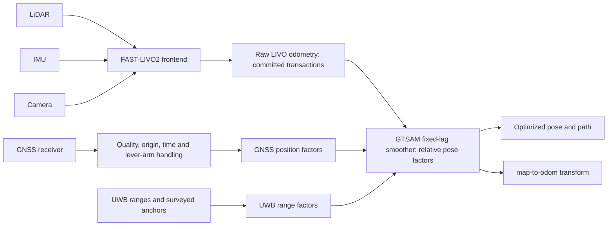

# FAST-LIVO-UG

**FAST-LIVO2 frontend with an independent GNSS/UWB fixed-lag backend (ROS 1).**

FAST-LIVO-UG is a modified [FAST-LIVO2](https://github.com/hku-mars/FAST-LIVO2)
catkin workspace. LiDAR, IMU and camera measurements produce raw LIVO odometry.
A GTSAM `IncrementalFixedLagSmoother` combines that odometry with GNSS position
and UWB range factors. Optimized poses are separate outputs: the backend does
**not** overwrite the frontend ESIKF state or covariance.

This is a research implementation, not a certified navigation product. The
public baseline before the 2026-10-28 cleanup is `e991e383`; its algorithm
commit is `9fe7e510` (tree-identical to the tested pre-rewrite commit `5be5538`).
The cleanup adds the public-tree and license-documentation changes described
below and is not pushed by this task. The public tunnel dataset is the
recommended reproduction entry. The 804 s competition recording is private and
is **not** the tunnel dataset; its numbers are internal validation only. See
[versioned experiments](docs/experiments/README.md) and
[release blockers](docs/RELEASE_READINESS.md) before redistributing a build.

| Area | Current status |
|---|---|
| FAST-LIVO2 frontend: LIO, VIO, scan/visual transactions | Maintainer-verified with `lio_plane_map_self_test` and the public tunnel replay; the voxel-key/neighbour fix is public in `9fe7e510` |
| GTSAM GNSS/UWB fixed-lag backend | Experimental/software-verified; no real simultaneous field-accuracy certification |
| Public tunnel dataset | Baidu share link and extraction code checked on 2026-10-28; file name, size and local SHA-256 recorded in [the tunnel page](docs/experiments/tunnel.md) |
| Core build without optional hardware | Whitelisted frontend/backend build checked in an isolated clone; no clean-host CI yet |
| License clearance | Not complete; the GPLv2-only/GPLv3 combined-work question and upstream driver/firmware terms remain open |

## Repository contents

The public tree is limited to the core estimator, its required messages and
time-sync support, and the MIT-licensed Livox driver:

| Path | Role | License status |
|---|---|---|
| [`src/FAST_LIVO2`](src/FAST_LIVO2) | Frontend, GNSS adapter, fixed-lag backend, tests | GPLv2; linked-license question open |
| [`src/rpg_vikit`](src/rpg_vikit) | Visual toolkit used by the frontend | GPLv3; license text added |
| [`src/gnss_comm`](src/gnss_comm) | GNSS message definitions | GPL-3.0-or-later |
| [`src/gnss_serial_driver`](src/gnss_serial_driver), [`src/uwb_serial_driver`](src/uwb_serial_driver) | Serial GNSS/UWB drivers | BSD-3-Clause; license text added |
| [`src/sensor_time_bridge`](src/sensor_time_bridge), [`src/sensor_time_msgs`](src/sensor_time_msgs) | Time synchronization and messages | BSD-3-Clause; license text added |
| [`src/sensor_recording_bringup`](src/sensor_recording_bringup) | Recording and readiness launch files | BSD-3-Clause; license text added |
| [`src/livox_ros_driver2`](src/livox_ros_driver2) | Optional Livox/MID-360 driver | MIT; Livox-SDK2 external |

The Hikrobot (`mvs_ros_driver`) camera wrapper, the `stm32_timersync-open`
firmware project and the bare `FAST-Calib` gitlink are **not** in the public
tree. They remain in the maintainer's local workspace. The camera wrapper's
upstream `package.xml` still has a `TODO` license, and the STM32 tree contains
ST/ARM vendor notices; LIV_handhold's top-level GPLv3 does not resolve either.
Install those components separately from
[LIV_handhold](https://github.com/xuankuzcr/LIV_handhold) and
[FAST-Calib](https://github.com/hku-mars/FAST-Calib) if needed. Real camera
capture is not required for the core build or the tunnel bag replay.

## Architecture



The graph diagram expresses data ownership, not sequential sensor processing.
GNSS and UWB constrain the same backend pose variables. There is no optimized
pose feedback arrow into LIVO. Rejected visual queries cannot publish
speculative motion to the backend. A completed LiDAR scan can publish its legal
predicted state if its measurement update is rejected.

Compared with the upstream frontend, this fork adds:

- GNSS adaptation, quality gating, lever-arm factors and a fixed-lag backend.
- UWB stamped range transport and range factors in that same graph, with
  explicit anchor-frame and timing requirements.
- IMU working queries and atomic state/P commits; rejected visual queries leave
  persistent propagation state unchanged.
- Initialization time alignment, 0/1-IMU interval coverage, consistent
  point/history time origins, boundary handling and protection against repeated
  deskew writes.
- Plane validity and tangential-distance checks, consistent VIO/LiDAR map keys
  (including floor-based negative-boundary keys and metre-based neighbour
  queries), and positive-depth support checks for plane-warped visual patches.
- Transaction tests, per-frame cloud export, and sensor recording/time bridges.

These changes do not establish full physical correctness of all deskew modes,
complete occlusion reasoning, arbitrary image-loss invariance, or absolute
accuracy.

## Build

Tested development environment: **Ubuntu 20.04, ROS Noetic, x86-64 RTX 2060
laptop**. The machine name is not a GPU specification. No Jetson throughput or
real-time navigation benchmark is claimed here. ROS 1/Ubuntu 20.04 are legacy
platforms; newer platforms require separate validation.

This repository is the **workspace root**, not a package to clone inside another
workspace's `src/` directory:

```bash
git clone https://github.com/gulu996/FAST-LIVO-UG.git ~/fast_livo_ug_ws
cd ~/fast_livo_ug_ws
source /opt/ros/noetic/setup.bash
```

Install the dependencies using the complete
[build guide](docs/BUILD_AND_CAPTURE.md). It covers the non-templated Sophus,
GTSAM 4.2 with `gtsam_unstable`, the bundled Vikit packages, an SDK-free core
build, and optional sensor drivers. No CUDA dependency is required by the core
frontend/backend build. Do not install a second Vikit copy into the workspace.

The core whitelist, which needs neither the MVS SDK nor Livox-SDK2, is:

```bash
catkin_make -j4 -DCMAKE_BUILD_TYPE=Release \
  -DCATKIN_WHITELIST_PACKAGES='sensor_time_msgs;sensor_time_bridge;gnss_comm;gnss_serial_driver;uwb_serial_driver;vikit_common;vikit_ros;sensor_recording_bringup;fast_livo'
source devel/setup.bash
roslaunch --files fast_livo mapping_mid360.launch
```

The complete workspace additionally builds `livox_ros_driver2` and needs
Livox-SDK2. The external MVS camera wrapper is not built by either command.
This is not a claim of clean-machine or CI validation.

## Public tunnel dataset and reproduction

The recommended public input is a self-collected tunnel recording shared by the
maintainer. It is a separate recording from the private competition 804 s bag.

- Baidu Netdisk: [share link](https://pan.baidu.com/s/1vArBc4Gn5unoczOqP880RQ?pwd=mbpr),
  extraction code `mbpr`
- Share folder: `/采集数据集/隧道`; file: `suidao2_resized.bag`
- Size: **16,334,415,367 bytes** (about 15.2 GiB)
- SHA-256 of the maintainer's exact-size local copy:
  `9289318857b0ca009dab4570ac6f51915de1681fe60b2abc0b481c20d6711169`
- Bag contents: 355 s, 78,063 messages; 3,549 `livox_ros_driver2/CustomMsg`
  LiDAR scans, 70,963 `sensor_msgs/Imu`, 3,551 raw `sensor_msgs/Image` frames
  (1300x1080, `rgb8`); topics `/livox/lidar`, `/livox/imu`,
  `/left_camera/image`. The bag clock starts at 510.32 s; always replay with
  `--clock`.
- Link check on 2026-10-28: the share page returned HTTP 200, the extraction code
  `mbpr` was accepted, and the file above was listed with the stated size. The
  file was **not** re-downloaded for this documentation pass; the SHA-256 is from
  the maintainer's local copy of the same size. Recompute it after download and
  contact the maintainer if it differs.

The bag is not part of this Git repository. The repository contains no copy of
the recording, site map or raw sensor payload. The maintainer states that the
recording is self-collected and shareable; users remain responsible for checking
privacy, participant and site constraints before further redistribution.

### Run the tunnel replay

Terminal 1 — ROS master:

```bash
source /opt/ros/noetic/setup.bash
source devel/setup.bash
roscore
```

Terminal 2 — explicit frontend startup (load parameters before the node):

```bash
source /opt/ros/noetic/setup.bash
source devel/setup.bash
rosparam set /use_sim_time true
PKG=$(rospack find fast_livo)
rosparam load "$PKG/config/mid360.yaml"
rosparam set /common/img_en 1
rosparam set /diagnostics/livo_scan_contract_en true
rosparam set /pcd_save/pcd_save_en false
rosparam load "$PKG/config/camera_pinhole_mid360.yaml" /laserMapping
rosrun fast_livo fastlivo_mapping __name:=laserMapping _save_path:=/tmp/tunnel_run
```

Terminal 3 — replay:

```bash
source /opt/ros/noetic/setup.bash
source devel/setup.bash
rosbag play --clock -r 1 -d 2 /path/to/suidao2_resized.bag \
  --topics /livox/lidar /livox/imu /left_camera/image
```

Notes:

- The tracked `config/mid360.yaml` defaults to `common/img_en: 0` (LiDAR/IMU
  only). The `rosparam set /common/img_en 1` line is required for the LIVO path
  and reflects the maintainer's local setting; it is not a committed config change.
- `config/camera_pinhole_mid360.yaml` is defined at 2600x2160 with `scale: 0.5`;
  it consumes the resized 1300x1080 stream directly. Do not rescale a second time.
- This bag has no GNSS or UWB data. Do not start the GNSS adapter or fixed-lag
  backend nodes for this replay.
- The maintainer's tunnel run used `img_en: 1`, i.e. **LIVO**, not a pure
  LiDAR/IMU run. It produced 3542 LIO commits and a first/last distance of
  **0.542 m**, with a maximum adjacent-scan speed of 2.02 m/s. These are
  revisit/stability diagnostics, **not ATE**, and accepted visual counts may
  vary with timing. The run was performed on pre-rewrite commit `5be5538`, whose
  tree is public as `9fe7e510`; no third party has independently reproduced it.

## Restricted internal competition replay

The ~804 s competition recording is private and is **not** the public tunnel
dataset. Internal runs on the tree of `02343a3` and on the tree of `9fe7e510`
(formerly called `5be5538`) gave first/last distances of about 1.070 m and
1.014 m respectively; these are stability/revisit diagnostics, not absolute
accuracy, and are not reproducible from this README. See
[competition 804](docs/experiments/competition-804.md) for the evidence scope.
Do not attribute the 804 s numbers to the tunnel recording.

## Live MID-360 hardware

For configured MID-360 hardware:

```bash
roslaunch fast_livo mapping_mid360.launch rviz:=true
```

Start the matching drivers separately (see the recording guide). The public tree
includes the MIT-licensed Livox driver but not the external Hikrobot camera
wrapper. `live_mid360.launch` defaults to `enable_camera:=false`; after
installing the MVS wrapper from LIV_handhold, pass `enable_camera:=true` for
camera capture. Without that external package the camera-enabled launch fails
with a clear “resource not found”, while the LiDAR-only path still resolves.

MID-360 launch has no `use_sim_time` argument: for bag replay, start `roscore`
and set `rosparam set /use_sim_time true` **before** launching it, then play with
`--clock`. Normal-rate replay is the reference; 2x playback is not a guaranteed
equivalent or loss-free mode. At EOF, inspect final callbacks and transaction
completion before stopping nodes; player exit alone does not prove delivery.

## GNSS only, UWB only, and both

Here “only” refers to external constraints; LiDAR/IMU/camera remain the frontend.
Use [FUSION_MODES.md](docs/FUSION_MODES.md) for complete parameter loading and
node commands. With `_use_gnss_fusion_enable:=true`:

| Mode | `gnss_fusion/enable` | `rtk_backend/enable` | `rtk_backend/uwb_factor_backend_en` |
|---|---:|---:|---:|
| Frontend only | false | false | false |
| GNSS only | true | true | false |
| UWB only | false | true | true |
| GNSS + UWB | true | true | true |

Set these **before node startup**, after loading the profile. Launch files reload
YAML, so a `rosparam set` before an unmodified launch may be overwritten.
Survey anchors into the backend map frame and calibrate antenna lever arms.
Do not enable the example anchors as if they described your site.
Legacy frontend `gps/update_en`, `uwb/update_en` and `uwb/mode` are not fusion modes.

## Main ROS interfaces

Names below are current configured defaults; a dataset can select different ones.

| Topic | Message / meaning |
|---|---|
| `/livox/lidar`, `/livox/imu` | MID-360 configured LiDAR and IMU inputs; check driver format |
| `/left_camera/image` | MID-360 profile `sensor_msgs/Image` input |
| `/tiaozhanbei/lidar`, `/tiaozhanbei/imu` | Competition `PointCloud2` and `Imu` inputs |
| `/petrochemical/camera/left/image_raw` | Decoded competition image input |
| `/aft_mapped_to_init` | Frontend `nav_msgs/Odometry`, local SLAM frame |
| `/backend/livo_odom_raw` | Transaction-completed frontend odometry for backend |
| `/gnss/pvt_local` | `gnss_serial_driver/GnssPvtStamped` |
| `/gnss_fusion/enu_odom`, `/gnss_fusion/status` | Adapted GNSS and `fast_livo/GnssStatus` |
| `/uwb/ranges` | Optional external `uwb_serial_driver/UwbRangeArray` |
| `/uwb/backend_ranges` | Time-associated ranges forwarded to the backend |
| `/rtk_backend/optimized_odom`, `/rtk_backend/optimized_path` | Optimized odometry/path |
| `/rtk_backend/map_to_odom`, `/rtk_backend/status` | Alignment transform and backend status |
| `/cloud_registered` | Registered world cloud |
| `/cloud_registered_frame` | Optional current-scan export; not the accumulated map |

`camera_init` is a local SLAM world frame, not automatically ENU or geographic
truth. Transform sensor-local points once; do not transform an already-world
cloud again. GNSS and UWB timestamps must refer to the estimator's time domain;
serial arrival time does not by itself establish physical measurement time.

## Configuration and layout

- [`src/FAST_LIVO2/launch`](src/FAST_LIVO2/launch): ROS mapping entrypoints.
- [`config/mid360.yaml`](src/FAST_LIVO2/config/mid360.yaml),
  [`camera_pinhole_mid360.yaml`](src/FAST_LIVO2/config/camera_pinhole_mid360.yaml):
  MID-360 profile and camera model.
- [`config/petrochemical_site`](src/FAST_LIVO2/config/petrochemical_site):
  competition sensor, camera, calibration and backend settings.
- [`gnss_adapter_mid360.yaml`](src/FAST_LIVO2/config/gnss_adapter_mid360.yaml),
  [`rtk_fixed_lag_backend_mid360.yaml`](src/FAST_LIVO2/config/rtk_fixed_lag_backend_mid360.yaml):
  GNSS quality/origin and backend factors.
- [`sensor_recording_bringup`](src/sensor_recording_bringup),
  [`sensor_time_bridge`](src/sensor_time_bridge),
  [`gnss_serial_driver`](src/gnss_serial_driver),
  [`uwb_serial_driver`](src/uwb_serial_driver): capture and stamped sensor inputs.
- [`docs/experiments`](docs/experiments/README.md): versioned results and limits.

The public tunnel replay uses `config/mid360.yaml` plus
`config/camera_pinhole_mid360.yaml`. The tracked `img_en` default is `0`; set it
to `1` at runtime as shown above to enable the visual path. The private
`config/petrochemical_site` profile is for the restricted competition recording,
not the tunnel dataset.

Keep experiment source copies outside ROS packages: recursive launch discovery
can make identical launch names ambiguous. Diagnose with `rospack find fast_livo`
and `roslaunch --files fast_livo mapping_mid360.launch` without starting hardware.

## Verification status

### Verified in the maintainer environment

- `lio_plane_map_self_test` passes on the `9fe7e510` algorithm tree; the formal
  `catkin_make --pkg fast_livo` build and a 20 s exact-config replay smoke test
  also passed. This is not a clean-clone CI result.
- The whitelisted core build in the isolated 2026-10-28 cleanup clone completed
  without the MVS SDK, Livox-SDK2, STM32 project or FAST-Calib. Native tests were
  run from that build; see [release readiness](docs/RELEASE_READINESS.md).
- Public tunnel replay on the `9fe7e510` tree (run as `5be5538`): LIVO with
  vision enabled, 3542 LIO commits, first/last **0.542 m**, maximum
  adjacent-scan speed 2.02 m/s. This includes the A5/A1 voxel-key/neighbour fix.
  First/last distance is a revisit diagnostic, not ATE; accepted visual counts
  can vary with timing.
- Internal competition 804 s: about 1.070 m on the tree of `02343a3` and 1.014 m
  on the tree of `9fe7e510`. The recording is private and is **not** the tunnel
  dataset; these numbers are internal stability/revisit diagnostics, not public
  reproduction results.
- The dataset share link, extraction code and listed file size were checked on
  2026-10-28. The maintainer's local copy has the same size and the SHA-256 in
  [the tunnel page](docs/experiments/tunnel.md); the file was not re-downloaded.

### Experimental

- GNSS adapter and GTSAM fixed-lag backend: software tests and recorded 90 s
  single-sensor runs exist; a synthetic joint graph uses declared common
  frame/time. **No real simultaneous GNSS+UWB field accuracy certification is
  claimed.**
- ZED integration, ArUco landmark fusion and shadow landmark/full-state modules
  are separate, experimental paths. They are not part of the verified core
  frontend and should not be enabled on the strength of the tunnel replay.
- Raycast mode, physical deskew/history consistency, general visual occlusion,
  arbitrary image-loss invariance and UWB device timing/antenna calibration
  remain research items. See the [experiment index](docs/experiments/README.md).

### Rejected, not part of `9fe7e510`

- A2 LiDAR query-covariance corrections: query-only tunnel first/last 2.159 m;
  query plus stored-map covariance 15.316 m. Both failed long-run regression.
- A6 scalar-`Exp` small-angle correction: tunnel 0.5475 m but competition
  72.76 m. Rejected.
- A5/A1+A6 combination: tunnel first/last 0.535 m but a 3.008 m reverse segment
  in 233–260 s. Rejected.

These candidates are not written up as fixed features. The internal audit report
is maintainer-local and is not linked as a public artifact.

### Not verified

- No independent reproduction of the tunnel result by a third party yet.
- No clean-clone build/CI on a clean host.
- No ground truth or ATE; no absolute accuracy certification.
- No real simultaneous GNSS+UWB field validation.
- No certification of all deskew modes, occlusion reasoning or image-loss
  invariance.

## License and acknowledgements

The FAST-LIVO2-derived component retains **GNU GPL version 2**; see
[LICENSE](LICENSE) and the original [package license](src/FAST_LIVO2/LICENSE).
Upstream states no “or later” grant, so this fork treats it as GPLv2-only.
`src/FAST_LIVO2/package.xml` was corrected from the inherited `BSD` tag to
`GPLv2`; that tag was never a relicensing grant. Other components retain their
own terms: `vikit_common`/`vikit_ros` and `gnss_comm` are GPLv3-family, the
self-developed sensor packages are BSD-3-Clause, and Livox is MIT.

The repository is not blanket MIT/BSD, and this fork does **not** relicense any
component to MIT, BSD or GPLv3. The [third-party register](THIRD_PARTY_LICENSES.md)
identifies the unresolved GPLv2-only/GPLv3 combined-work question (the linked
Vikit components and `gnss_comm`), the external MVS wrapper's upstream `TODO`
license, and firmware/vendor notices. Moving a component to a submodule or a
separate clone does not by itself resolve the compatibility question.

The source tree is **not currently certified release-ready**. Resolving the
linked GPL version question and confirming driver/firmware/data permissions are
follow-up actions, not claims made by this README. See
[release readiness](docs/RELEASE_READINESS.md).

Credit belongs to Chunran Zheng, Fu Zhang and the FAST-LIVO2/FAST-LIVO authors,
and to contributors to LOAM, RPG Vikit/PTAM/dvo, GTSAM, Livox, gnss_comm and the
other components named in the register. Existing source copyright notices are
preserved. Upstream offers discussion of an alternative commercial license
through Chunran Zheng (`zhengcr@connect.hku.hk`) and Fu Zhang (`fuzhang@hku.hk`);
this fork does not grant that alternative license.

Please cite the upstream algorithm when using it:

```bibtex
@article{zheng2024fastlivo2,
  title={FAST-LIVO2: Fast, Direct LiDAR-Inertial-Visual Odometry},
  author={Zheng, Chunran and Xu, Wei and Zou, Zuhao and Hua, Tong and
          Yuan, Chongjian and He, Dongjiao and Zhou, Bingyang and Liu, Zheng and Lin, Jiarong and Zhu, Fangcheng and
          Ren, Yunfan and Wang, Rong and Meng, Fanle and Zhang, Fu},
  journal={arXiv preprint arXiv:2408.14035},
  year={2024}
}
```

[FAST-LIVO2 paper](https://arxiv.org/abs/2408.14035) ·
[FAST-LIVO paper](https://arxiv.org/abs/2203.00893) ·
[Upstream calibration](https://github.com/hku-mars/FAST-Calib) ·
[Upstream hardware](https://github.com/xuankuzcr/LIV_handhold)

For an issue, include the commit, build environment, launch/configuration,
message types, time/frame conventions and a small redistributable reproducer.
Do not attach credentials, private site maps or unlicensed recordings.
