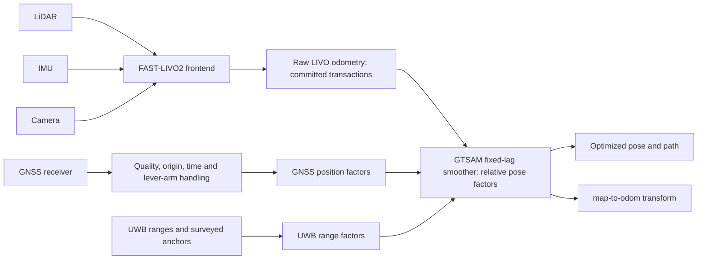

# FAST-LIVO-UG

**FAST-LIVO2 frontend with an independent GNSS/UWB fixed-lag backend (ROS 1).**

FAST-LIVO-UG is a modified [FAST-LIVO2](https://github.com/hku-mars/FAST-LIVO2)
catkin workspace. LiDAR, IMU and camera measurements produce raw LIVO odometry.
A GTSAM `IncrementalFixedLagSmoother` combines that odometry with GNSS position
and UWB range factors. Optimized poses are separate outputs: the backend does
**not** overwrite the frontend ESIKF state or covariance.

This is a research implementation, not a certified navigation product.
The documented algorithm revision is `d9497af2234d3fd368dfdc072918d81c5d59a585`.
See [versioned experiments](docs/experiments/README.md) for tested configurations
and [release blockers](docs/RELEASE_READINESS.md) before redistributing a build.
The local validated revision and the published GitHub branch can differ.

## Architecture



The graph diagram expresses data ownership, not sequential sensor processing.
GNSS and UWB constrain the same backend pose variables. There is no optimized
pose feedback arrow into LIVO. Rejected visual queries cannot publish speculative
motion to the backend. A completed LiDAR scan can publish its legal predicted
state if its measurement update is rejected.

Compared with the upstream frontend, this fork adds:

- GNSS adaptation, quality gating, lever-arm factors and a fixed-lag backend.
- UWB stamped range transport and range factors in that same graph, with
  explicit anchor-frame and timing requirements.
- IMU working queries and atomic state/P commits; rejected visual queries leave
  persistent propagation state unchanged.
- Initialization time alignment, 0/1-IMU interval coverage, consistent point/history
  time origins, boundary handling and protection against repeated deskew writes.
- Plane validity and tangential-distance checks, consistent VIO/LiDAR map keys,
  and positive-depth support checks for plane-warped visual patches.
- Transaction tests, per-frame cloud export, and sensor recording/time bridges.

These changes do not establish full physical correctness of all deskew modes,
complete occlusion reasoning, arbitrary image-loss invariance, or absolute accuracy.

## Build

Tested development environment: **Ubuntu 20.04, ROS Noetic, x86-64 RTX 2060 laptop**.
The machine name is not a GPU specification. No Jetson throughput or real-time
navigation benchmark is claimed here. ROS 1/Ubuntu 20.04 are legacy platforms;
newer platforms require separate validation.

This repository is the **workspace root**, not a package to clone inside another
workspace's `src/` directory:

```bash
git clone https://github.com/gulu996/FAST-LIVO-UG.git ~/fast_livo_ug_ws
cd ~/fast_livo_ug_ws
source /opt/ros/noetic/setup.bash
```

Install the dependencies and build using the complete
[build guide](docs/BUILD_AND_CAPTURE.md). It covers the non-templated Sophus,
GTSAM 4.2 with `gtsam_unstable`, the bundled Vikit packages, an SDK-free core
build, and optional sensor drivers. No CUDA dependency is required by the core
frontend/backend build. Do not install a second Vikit copy into the workspace.

## Minimal run

After building, source `devel/setup.bash` in **every terminal**. Pick the profile
matching the data, intrinsics, extrinsics, units and time conventions. Neither
profile is universal calibration.

For the petrochemical dataset profile:

```bash
source ~/fast_livo_ug_ws/devel/setup.bash
roslaunch fast_livo mapping_petrochemical_site.launch use_sim_time:=true rviz:=false
```

In another terminal, after subscriber initialization:

```bash
source ~/fast_livo_ug_ws/devel/setup.bash
rosbag info /path/to/competition.bag
rosbag play --clock -r 1 -d 2 /path/to/competition.bag \
  /tiaozhanbei/camera/left/image/compressed:=/petrochemical/camera/left/image_raw/compressed
```

This is a normal launch example, **not** the historical instrumented DROP2
experiment. The stock launch uses `image_transport republish`; the published
regression counts used a separate traced queue-8 decoder. See the experiment
pages for that distinction. The competition bag is not distributed here.
The petrochemical launch loads GNSS settings too; use the explicit
[fusion-mode startup](docs/FUSION_MODES.md) for frontend-only or controlled modes.
Its current output directory is dataset-specific; the same guide shows how to
set a writable output directory before starting nodes.

For configured MID-360 hardware:

```bash
roslaunch fast_livo mapping_mid360.launch rviz:=true
```

Start the matching drivers separately (see the recording guide). MID-360 launch
has no `use_sim_time` argument: for bag replay, start `roscore` and set
`rosparam set /use_sim_time true` **before** launching it, then play with `--clock`.
Normal-rate replay is the reference; 2x playback is not a guaranteed equivalent
or loss-free mode. At EOF, inspect final callbacks and transaction completion
before stopping nodes; player exit alone does not prove delivery.

## GNSS only, UWB only, and both

Here “only” refers to external constraints; LiDAR/IMU/camera remain the frontend.
Use [FUSION_MODES.md](docs/FUSION_MODES.md) for complete parameter loading and
node commands. With `_use_gnss_fusion_enable:=true`:

| Mode | `gnss_fusion/enable` | `rtk_backend/enable` | `rtk_backend/uwb_factor_backend_en` |
|---|---:|---:|---:|
| Frontend only | false | false | false |
| GNSS only | true | true | false |
| UWB only | false | true | true |
| GNSS + UWB | true | true | true |

Set these **before node startup**, after loading the profile. Launch files reload
YAML, so a `rosparam set` before an unmodified launch may be overwritten.
Survey anchors into the backend map frame and calibrate antenna lever arms.
Do not enable the example anchors as if they described your site.
Legacy frontend `gps/update_en`, `uwb/update_en` and `uwb/mode` are not fusion modes.

## Main ROS interfaces

Names below are current configured defaults; a dataset can select different ones.

| Topic | Message / meaning |
|---|---|
| `/livox/lidar`, `/livox/imu` | MID-360 configured LiDAR and IMU inputs; check driver format |
| `/left_camera/image` | MID-360 profile `sensor_msgs/Image` input |
| `/tiaozhanbei/lidar`, `/tiaozhanbei/imu` | Competition `PointCloud2` and `Imu` inputs |
| `/petrochemical/camera/left/image_raw` | Decoded competition image input |
| `/aft_mapped_to_init` | Frontend `nav_msgs/Odometry`, local SLAM frame |
| `/backend/livo_odom_raw` | Transaction-completed frontend odometry for backend |
| `/gnss/pvt_local` | `gnss_serial_driver/GnssPvtStamped` |
| `/gnss_fusion/enu_odom`, `/gnss_fusion/status` | Adapted GNSS and `fast_livo/GnssStatus` |
| `/uwb/ranges` | Optional external `uwb_serial_driver/UwbRangeArray` |
| `/uwb/backend_ranges` | Time-associated ranges forwarded to the backend |
| `/rtk_backend/optimized_odom`, `/rtk_backend/optimized_path` | Optimized odometry/path |
| `/rtk_backend/map_to_odom`, `/rtk_backend/status` | Alignment transform and backend status |
| `/cloud_registered` | Registered world cloud |
| `/cloud_registered_frame` | Optional current-scan export; not the accumulated map |

`camera_init` is a local SLAM world frame, not automatically ENU or geographic
truth. Transform sensor-local points once; do not transform an already-world
cloud again. GNSS and UWB timestamps must refer to the estimator's time domain;
serial arrival time does not by itself establish physical measurement time.

## Configuration and layout

- [`src/FAST_LIVO2/launch`](src/FAST_LIVO2/launch): ROS mapping entrypoints.
- [`config/mid360.yaml`](src/FAST_LIVO2/config/mid360.yaml),
  [`camera_pinhole_mid360.yaml`](src/FAST_LIVO2/config/camera_pinhole_mid360.yaml):
  MID-360 profile and camera model.
- [`config/petrochemical_site`](src/FAST_LIVO2/config/petrochemical_site):
  competition sensor, camera, calibration and backend settings.
- [`gnss_adapter_mid360.yaml`](src/FAST_LIVO2/config/gnss_adapter_mid360.yaml),
  [`rtk_fixed_lag_backend_mid360.yaml`](src/FAST_LIVO2/config/rtk_fixed_lag_backend_mid360.yaml):
  GNSS quality/origin and backend factors.
- [`sensor_recording_bringup`](src/sensor_recording_bringup),
  [`sensor_time_bridge`](src/sensor_time_bridge),
  [`gnss_serial_driver`](src/gnss_serial_driver),
  [`uwb_serial_driver`](src/uwb_serial_driver): capture and stamped sensor inputs.
- [`docs/experiments`](docs/experiments/README.md): versioned results and limits.

Keep experiment source copies outside ROS packages: recursive launch discovery
can make identical launch names ambiguous. Diagnose with `rospack find fast_livo`
and `roslaunch --files fast_livo mapping_mid360.launch` without starting hardware.

## Validation status

The latest isolated frontend candidate completed three ~804 s runs: pure LIO,
LIVO and exact two-image omission. The integrated source matched the candidate,
and the formal build passed a 20 s online comparison. This does not mean a new
804 s run was performed with the formal installed binary.

Separate recorded GNSS and UWB software regressions and a synthetic joint graph
test exist. **No real simultaneous GNSS+UWB field positioning accuracy
certification is claimed.** Data availability, sample counts, versions and
commands are in the [experiment index](docs/experiments/README.md).

Remaining research includes broader scene coverage, general visual occlusion,
raycast mode, physical deskew/history consistency, UWB device timing/antenna
calibration and real joint-frame validation. Shadow landmark/full-state modules
are experimental. Do not enable them on the strength of the frontend tests.

## License and acknowledgements

The FAST-LIVO2-derived component retains **GNU GPL version 2**; see
[LICENSE](LICENSE) and the original [package license](src/FAST_LIVO2/LICENSE).
Other components retain their own terms. The repository is not blanket MIT/BSD.
The [third-party register](THIRD_PARTY_LICENSES.md) identifies unresolved
GPLv2/GPLv3 combination, driver and firmware redistribution questions; adding a
license file is not clearance for those components.

Credit belongs to Chunran Zheng, Fu Zhang and the FAST-LIVO2/FAST-LIVO authors,
and to contributors to LOAM, RPG Vikit/PTAM/dvo, GTSAM, Livox, gnss_comm and the
other components named in the register. Existing source copyright notices are
preserved. Upstream offers discussion of an alternative commercial license
through Chunran Zheng (`zhengcr@connect.hku.hk`) and Fu Zhang (`fuzhang@hku.hk`);
this fork does not grant that alternative license.

Please cite the upstream algorithm when using it:

```bibtex
@article{zheng2024fastlivo2,
  title={FAST-LIVO2: Fast, Direct LiDAR-Inertial-Visual Odometry},
  author={Zheng, Chunran and Xu, Wei and Zou, Zuhao and Hua, Tong and
          Yuan, Chongjian and He, Dongjiao and Zhou, Bingyang and Liu, Zheng and Lin, Jiarong and Zhu, Fangcheng and
          Ren, Yunfan and Wang, Rong and Meng, Fanle and Zhang, Fu},
  journal={arXiv preprint arXiv:2408.14035},
  year={2024}
}
```

[FAST-LIVO2 paper](https://arxiv.org/abs/2408.14035) ·
[FAST-LIVO paper](https://arxiv.org/abs/2203.00893) ·
[Upstream calibration](https://github.com/hku-mars/FAST-Calib) ·
[Upstream hardware](https://github.com/xuankuzcr/LIV_handhold)

For an issue, include the commit, build environment, launch/configuration,
message types, time/frame conventions and a small redistributable reproducer.
Do not attach credentials, private site maps or unlicensed recordings.
